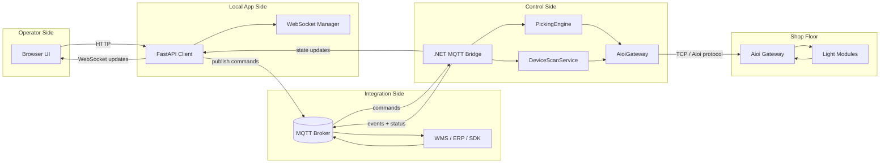
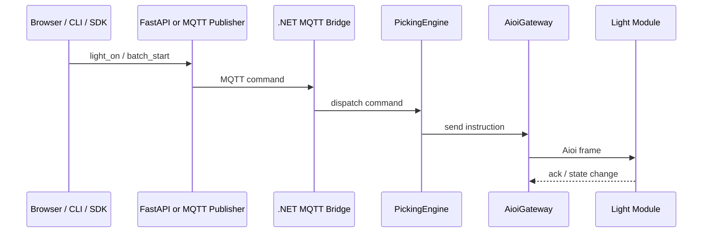
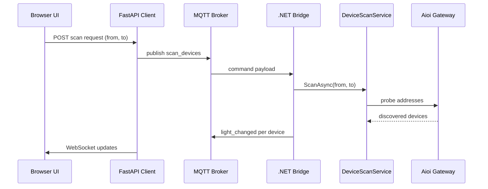

# Pick2Light Architecture Guide

This document explains how Pick2Light (P2L) is structured, how data flows through the system, and which runtime responsibilities belong to each component.

---

## 1. System Overview

P2L is a warehouse light-control platform for Aioi Systems gateways and light modules. It combines:

- a native .NET bridge for hardware control
- an optional MQTT integration layer for upstream systems
- a standalone web client for operators and configuration

At runtime, the platform sits between three worlds:

1. Aioi hardware on the shop floor
2. MQTT/WMS/ERP integrations
3. local operators using the dashboard and web UI

---

## 2. High-Level Context

```text
Browser UI
   │
   │ HTTP / WebSocket
   ▼
Python FastAPI client
   │
   │ MQTT commands / events
   ▼
.NET MQTT bridge
   │
   │ TCP (Aioi protocol)
   ▼
Aioi Gateway
   │
   ▼
Light modules / button confirmations
```

The browser never talks to the hardware directly. Hardware access always goes through the .NET bridge.

### Architecture diagram



---

## 3. Runtime Building Blocks

### 3.1 `P2L.Shared`

Shared contracts and constants used by the rest of the solution:

- enums such as colors and module state
- DTOs for light state, picking instructions, and confirmations
- protocol-safe shared types with minimal dependencies

This project stays low-level and dependency-light so it can be reused safely across layers.

### 3.2 `P2L.Hardware`

Responsible for physical communication with Aioi hardware.

Main responsibilities:

- TCP socket lifecycle
- framing and parsing Aioi protocol packets
- request/response correlation
- immediate confirm ACK handling
- reconnection and send serialization

Key types:

- `TcpTransport`
- `AioiGateway`
- `AioiEncoder` / `AioiDecoder`
- protocol packet models

Important design points:

- requests are serialized to protect the gateway connection
- pending responses are matched by sequence number
- button interrupts must be ACKed quickly with the `"O"` command
- keep-alive is maintained by periodic heartbeat traffic

### 3.3 `P2L.Core`

Contains the business logic of the system.

Main responsibilities:

- track current light/module state
- manage batch picking workflows
- process confirmations
- scan devices
- run CSV-driven jobs
- coordinate self-healing and watchdog behavior

Key types:

- `PickingEngine`
- `LightModuleRegistry`
- `HeartbeatService`
- `DeviceScanService`
- `CsvPickTaskRunner`
- `PreemptionGate`
- `WatchdogService`

This layer is intentionally isolated from transport details where possible.

### 3.4 `P2L.Mqtt`

Provides the integration bridge between the core system and MQTT.

Main responsibilities:

- connect to the broker, optionally with TLS
- subscribe to command topics
- deserialize commands with source-generated JSON
- dispatch commands into core services
- publish events and status back to MQTT
- buffer outbound events when broker connectivity is lost

Key types:

- `MqttBridgeService`
- `MqttCommandDispatcher`
- `MqttEventPublisher`
- `P2LMqttJsonContext`

Design notes:

- command handling is topic-gated so device event topics are not misrouted as commands
- retained-message cleanup on startup has been removed; retained topics are now left untouched
- the bridge publishes online/offline state and gateway connectivity separately

### 3.5 `P2L.CLI`

The native operational entry point.

Main responsibilities:

- command-line commands
- dashboard execution
- dependency injection wiring
- configuration loading
- file logging
- self-heal hosting integration

This is the deployable .NET host used in production packaging.

### 3.6 `client/` FastAPI web client

Provides the browser-based dashboard and operator-facing configuration screens.

Main responsibilities:

- serve the web application
- expose REST endpoints for local actions
- maintain WebSocket sessions for live updates
- keep operator state visible without direct broker access from the browser
- persist local labels and client settings

Key areas:

- `client/app/api/routes.py` for REST APIs
- `client/app/api/ws_manager.py` for WebSocket fan-out
- `client/static/js/app.js` for the SPA behavior
- `client/templates/index.html` for the shell UI

Recent behavior decisions:

- browser reload no longer disconnects MQTT immediately
- the client keeps the session alive and disconnects only after 15 minutes without active browser sessions
- the scan-devices UI is isolated in `Settings -> Scan Devices`

---

## 4. Core Execution Flows

### 4.1 Light control flow

```text
CLI / Web Client / MQTT command
           │
           ▼
     PickingEngine
           │
           ▼
      AioiGateway
           │
           ▼
    Aioi light module
```

The engine decides what should happen; the hardware layer decides how to encode and send it.



### 4.2 Confirmation flow

```text
Button press on module
        │
        ▼
 Aioi interrupt frame
        │
        ▼
  AioiGateway ACKs immediately
        │
        ▼
 ConfirmationEvent raised
        │
        ├─> PickingEngine updates batch state
        └─> MQTT publisher emits event
```

Immediate ACK is critical to avoid lost or repeated confirmations.

### 4.3 Web dashboard flow

```text
Browser action
   │
   ▼
FastAPI route
   │
   ▼
MQTT command publish
   │
   ▼
.NET bridge
   │
   ▼
Core + hardware
```

State updates move back in the opposite direction through MQTT and WebSocket broadcast.

### 4.4 Device scan flow

```text
User starts scan in web UI
        │
        ▼
FastAPI publishes `scan_devices`
        │
        ▼
MqttCommandDispatcher
        │
        ▼
DeviceScanService.ScanAsync(from, to)
        │
        ▼
Discovered device states published and rendered live
```

The frontend disables the scan button while a scan is in progress and renders found devices in real time.



---

## 5. State Management

### 5.1 Hardware and module state

The .NET side uses in-memory state for active runtime behavior:

- registry of known modules
- batch progress and pending confirmations
- current bridge/gateway health

`LightModuleRegistry` is the single source of truth for live device state inside the bridge.

### 5.2 Client-side persisted state

The Python client persists local metadata such as:

- device labels
- user configuration
- UI-oriented lookup data

This keeps operator-friendly naming separate from core transport behavior.

### 5.3 Session state in the browser path

The browser itself is disposable. A page refresh should not tear down the backend connection immediately. The server now owns session liveness and applies an idle timeout instead of hard-disconnecting on reload.

---

## 6. Reliability Model

P2L is designed for unattended shop-floor operation.

Reliability features include:

- TCP auto-reconnect to the gateway
- MQTT reconnect loop
- heartbeat packets to keep the gateway session alive
- watchdog logic for long disconnections
- self-healing process restart support
- rotating file logs
- offline event buffering on the MQTT side

This keeps control traffic stable even when the network or broker is unstable.

---

## 7. Deployment Model

### Bridge

The bridge is packaged as a Native AOT, self-contained executable. It is intended to run as:

- `systemd` service on Linux
- Windows Service on Windows
- local binary on macOS or development machines

### Web client

The web client is also packaged for standalone deployment so operators do not need Python installed on the target machine.

### Configuration

Deployment-time configuration is based on adjacent JSON files and installer-provided defaults. The bridge and client are deployed together but remain logically separate services.

---

## 8. Design Constraints

Several project decisions are driven by operational constraints:

- Native AOT compatibility: avoid reflection-heavy runtime binding
- hardware safety: preserve strict command framing and ACK timing
- concurrency safety: queue and serialize transport writes
- 24/7 uptime: prefer reconnect/retry behavior over fail-fast exits
- operator simplicity: expose most workflows through the web UI and stable install scripts

---

## 9. Recommended Reading

- `README.md` for build, configuration, and command reference
- `docs/USAGE.md` for operator/developer usage
- `BUILD.md` for packaging details
- `WINDOWS_INSTALL.md` for Windows deployment
