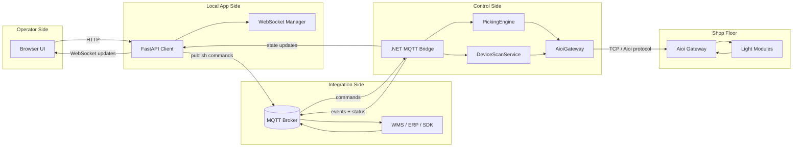
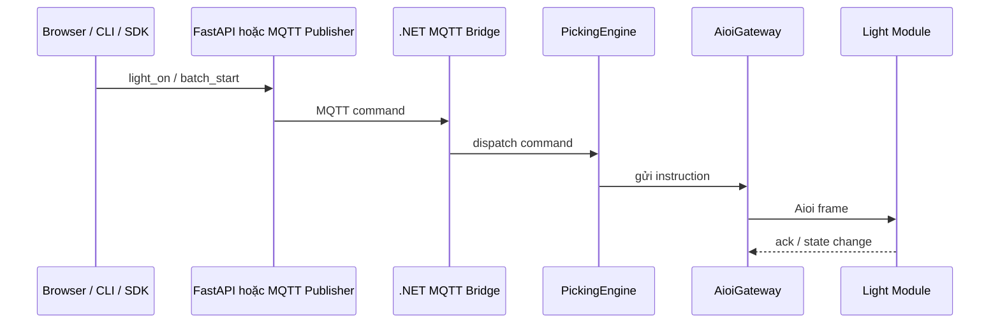
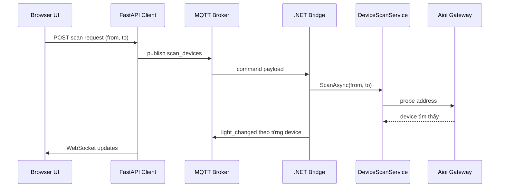

# Tài liệu Kiến trúc Pick2Light

Tài liệu này mô tả cách Pick2Light (P2L) được tổ chức, dữ liệu chạy qua hệ thống như thế nào, và mỗi thành phần chịu trách nhiệm gì trong runtime.

---

## 1. Tổng quan hệ thống

P2L là nền tảng điều khiển đèn pick-to-light cho gateway và light module của Aioi Systems. Hệ thống gồm:

- bridge .NET native để điều khiển phần cứng
- lớp tích hợp MQTT cho hệ thống bên ngoài
- web client độc lập cho vận hành và cấu hình

Trong runtime, P2L đứng giữa ba phía:

1. phần cứng Aioi trên hiện trường
2. hệ thống tích hợp MQTT / WMS / ERP
3. người vận hành dùng dashboard hoặc web UI

---

## 2. Bối cảnh tổng thể

```text
Trình duyệt
   │
   │ HTTP / WebSocket
   ▼
FastAPI client
   │
   │ MQTT commands / events
   ▼
.NET MQTT bridge
   │
   │ TCP (giao thức Aioi)
   ▼
Aioi Gateway
   │
   ▼
Light module / nút xác nhận
```

Trình duyệt không giao tiếp trực tiếp với phần cứng. Mọi thao tác với hardware đều đi qua .NET bridge.

### Sơ đồ kiến trúc



---

## 3. Các khối runtime chính

### 3.1 `P2L.Shared`

Chứa contract và constant dùng chung:

- enum về màu, trạng thái module
- DTO cho trạng thái đèn, picking instruction, confirmation
- kiểu dữ liệu dùng chung, ít phụ thuộc

### 3.2 `P2L.Hardware`

Phụ trách giao tiếp vật lý với phần cứng Aioi.

Nhiệm vụ chính:

- quản lý TCP socket
- encode/decode gói Aioi
- ghép request/response theo sequence
- ACK confirm ngay lập tức
- reconnect và serialize việc gửi dữ liệu

Thành phần chính:

- `TcpTransport`
- `AioiGateway`
- `AioiEncoder` / `AioiDecoder`

Điểm quan trọng:

- lệnh được serialize để bảo vệ connection đến gateway
- response được match bằng sequence number
- interrupt từ nút nhấn phải được ACK nhanh bằng lệnh `"O"`
- heartbeat giữ cho session phần cứng không bị timeout

### 3.3 `P2L.Core`

Chứa business logic của hệ thống.

Nhiệm vụ chính:

- theo dõi trạng thái module
- chạy workflow pick theo batch
- xử lý xác nhận
- scan thiết bị
- chạy job từ CSV
- phối hợp watchdog và self-heal

Thành phần chính:

- `PickingEngine`
- `LightModuleRegistry`
- `HeartbeatService`
- `DeviceScanService`
- `CsvPickTaskRunner`
- `PreemptionGate`
- `WatchdogService`

### 3.4 `P2L.Mqtt`

Lớp bridge giữa core system và MQTT.

Nhiệm vụ chính:

- kết nối broker, có thể dùng TLS
- subscribe command topic
- deserialize command bằng source-generated JSON
- dispatch command vào core
- publish event / status ngược ra MQTT
- buffer event outbound khi broker bị mất kết nối

Thành phần chính:

- `MqttBridgeService`
- `MqttCommandDispatcher`
- `MqttEventPublisher`
- `P2LMqttJsonContext`

Ghi chú thiết kế:

- dispatcher chỉ xử lý command topic, tránh nhầm device event thành command
- tính năng xóa retained message khi startup đã bị loại bỏ
- retained topic trên broker hiện được giữ nguyên sau khi bridge restart

### 3.5 `P2L.CLI`

Entry point native để chạy production.

Nhiệm vụ:

- CLI commands
- dashboard mode
- dependency injection
- load config
- file logging
- self-heal hosting

### 3.6 `client/` FastAPI web client

Giao diện web cho operator và quản trị cấu hình.

Nhiệm vụ:

- phục vụ web app
- expose REST API
- giữ WebSocket session để đẩy live update
- hiển thị trạng thái hệ thống mà không để browser chạm broker trực tiếp
- lưu label thiết bị và config cục bộ

Thành phần chính:

- `client/app/api/routes.py`
- `client/app/api/ws_manager.py`
- `client/static/js/app.js`
- `client/templates/index.html`

Quyết định runtime gần đây:

- reload trang không còn disconnect MQTT ngay
- client giữ session sống và chỉ ngắt sau 15 phút không còn browser active
- giao diện scan devices nằm trong `Settings -> Scan Devices`

---

## 4. Các luồng xử lý chính

### 4.1 Luồng điều khiển đèn

```text
CLI / Web Client / MQTT command
           │
           ▼
     PickingEngine
           │
           ▼
      AioiGateway
           │
           ▼
     Light module
```

Business logic quyết định cần làm gì, còn hardware layer quyết định encode và gửi như thế nào.



### 4.2 Luồng xác nhận

```text
Nút trên module được nhấn
        │
        ▼
 Frame interrupt từ Aioi
        │
        ▼
  AioiGateway ACK ngay
        │
        ▼
 ConfirmationEvent được tạo
        │
        ├─> PickingEngine cập nhật batch
        └─> MQTT publisher phát event
```

ACK ngay lập tức là điểm rất quan trọng để không mất xác nhận.

### 4.3 Luồng web dashboard

```text
Browser action
   │
   ▼
FastAPI route
   │
   ▼
MQTT command publish
   │
   ▼
.NET bridge
   │
   ▼
Core + hardware
```

State update quay ngược về browser qua MQTT rồi qua WebSocket.

### 4.4 Luồng scan thiết bị

```text
User bấm scan trên web UI
        │
        ▼
FastAPI publish `scan_devices`
        │
        ▼
MqttCommandDispatcher
        │
        ▼
DeviceScanService.ScanAsync(from, to)
        │
        ▼
Device được phát hiện và render realtime
```



Trong lúc scan, nút scan bị disable và kết quả hiển thị realtime.

---

## 5. Quản lý state

### 5.1 State runtime phía .NET

Bridge giữ state trong memory cho:

- registry các module đã biết
- tiến độ batch và confirmation đang chờ
- tình trạng bridge / gateway

`LightModuleRegistry` là nguồn sự thật chính cho device state đang chạy.

### 5.2 State persisted phía client

Python client lưu dữ liệu cục bộ như:

- label thiết bị
- config người dùng
- dữ liệu phục vụ UI

### 5.3 Session state phía browser

Browser là thành phần có thể reload bất cứ lúc nào. Reload trang không nên làm backend disconnect ngay. Hiện tại server giữ session và chỉ áp dụng idle timeout nếu không còn browser active.

---

## 6. Mô hình độ tin cậy

P2L được thiết kế cho môi trường vận hành liên tục.

Các cơ chế chính:

- TCP auto-reconnect đến gateway
- MQTT reconnect loop
- heartbeat giữ session gateway
- watchdog cho tình huống mất kết nối lâu
- self-healing restart
- rotating log files
- offline event buffering khi MQTT lỗi

---

## 7. Mô hình triển khai

### Bridge

Bridge được đóng gói thành executable Native AOT, self-contained. Có thể chạy dưới dạng:

- `systemd` trên Linux
- Windows Service trên Windows
- local binary trên macOS hoặc máy dev

### Web client

Web client cũng được đóng gói để máy đích không cần cài Python.

### Configuration

Config runtime dựa trên JSON files đặt cạnh binary hoặc trong thư mục config do installer tạo sẵn.

---

## 8. Ràng buộc thiết kế

- phải tương thích Native AOT
- phải ACK confirm đủ nhanh để an toàn với hardware
- phải serialize ghi xuống transport
- ưu tiên reconnect/retry để chạy 24/7
- UI cần đơn giản cho operator

---

## 9. Nên đọc tiếp

- `README.md` để xem build, config và command reference
- `docs/USAGE.md` hoặc `docs/USAGE.vi.md` để xem cách dùng
- `BUILD.md` để xem packaging
- `WINDOWS_INSTALL.md` để xem cài đặt trên Windows

