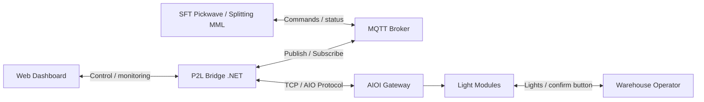

# Pick2Light (P2L) — Executive Architecture Overview

This document is intended for managers and decision-makers. Its goal is to explain, at a high level, what the P2L platform does, how the solution is structured, and what operational value it delivers.

---

## 1. What P2L Is

P2L is a pick-to-light control platform for warehouse operations.

When a picking instruction is issued:

- the central system sends a request
- lights turn on at the required picking locations
- warehouse operators confirm directly on the module
- status is sent back to the system in real time

The main objectives are:

- reduce picking errors
- improve operator speed
- provide real-time operational visibility
- create a foundation for integration with **SFT Pickwave / Splitting MML**

---

## 2. Overall Solution Model

The system is organized into 4 main layers:

1. **Web Client / Dashboard**
   - operator-facing interface
   - shows service status, device status, scan results, and configuration

2. **P2L Bridge (.NET)**
   - the core orchestration component
   - receives commands from the web UI or MQTT
   - converts business requests into hardware communication

3. **MQTT / Integration Layer**
   - connects the platform to external systems such as **SFT Pickwave / Splitting MML**
   - carries commands into the bridge and events back out

4. **AIOI Gateway + Light Modules**
   - the physical execution layer on the shop floor
   - displays lights, quantities, buzzer states, and receives operator confirmations

### What MQTT Is

MQTT is a lightweight publish/subscribe messaging standard commonly used for industrial and IoT integration.

In P2L, MQTT acts as the communication layer between:

- business systems such as **SFT Pickwave / Splitting MML**
- the P2L Bridge
- other integration services or applications

In simple terms, MQTT lets external systems send commands to P2L and receive status updates without connecting directly to the hardware.

---

## 3. Management-Level Architecture Diagram

In simple terms:

- operators interact through the web dashboard
- business systems integrate through MQTT
- the P2L Bridge is the control center
- the AIOI gateway and light modules execute actions on the warehouse floor

---

## 4. Simple Operational Flow

A typical picking flow looks like this:

1. **SFT Pickwave / Splitting MML** or an operator creates a picking request
2. the request enters the P2L Bridge
3. the bridge sends the instruction to the AIOI gateway
4. lights turn on at the required pick locations
5. the warehouse operator picks items and confirms on the module
6. the confirmation returns to the bridge
7. the dashboard and upstream systems receive real-time updates

---

## 5. Role of Each Component

### Web Dashboard

- supports local operations
- provides configuration screens
- shows service status
- supports device scanning
- gives real-time operational visibility

### P2L Bridge

- is the core system component
- connects directly to AIOI hardware
- handles light-control logic
- manages batch picking, confirmations, and device scanning
- publishes state and events to MQTT

### MQTT Layer

- provides an open integration standard
- allows easy connection to external software
- supports multi-system warehouse or factory environments

### Gateway and Light Modules

- execute instructions on the shop floor
- show lights, quantities, and buzzer behavior
- receive direct confirmations from operators

---

## 6. Practical Deployment Model

The target deployment model is:

- 1 mini computer, such as a **Raspberry Pi**, running the **P2L Bridge**
- 1 **MQTT Broker**
- 1 **AIOI** controller / light-device system

In this model, the P2L Bridge is the control center, the MQTT Broker is the messaging integration layer, and the AIOI system is the execution layer on the warehouse floor.

---

## 7. Operational Strengths

- reconnect behavior for lost connections
- heartbeat to keep the gateway session alive
- logging for traceability and troubleshooting
- self-heal / watchdog support for 24/7 operation
- resilient web UI behavior that does not immediately disconnect on browser reload

In short, the platform is designed for continuous warehouse operation.

---
