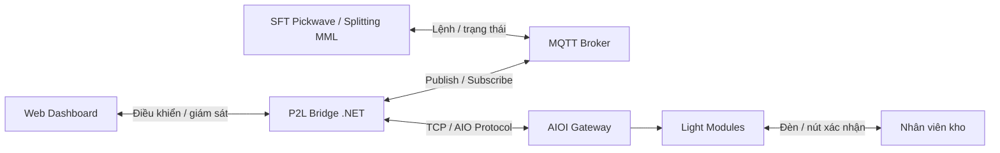

# Tổng quan mô hình - Pick2Light (P2L)

Author: ThangLam

---

## 1. Sơ đồ kiến trúc

Ý nghĩa ngắn gọn:

- Hệ thống **SFT Pickwave / Splitting MML** gửi danh sách chia hàng tới **P2L Bridge** thông qua **MQTT Broker**
- **P2L Bridge** nhận lệnh, chuyển đổi lệnh và gửi lệnh vào **AIOI Gateway**
- **P2L Bridge** là thành phần trung tâm xử lý
- Nhân viên kho tương tác với thiết bị đèn; **AIOI Gateway** nhận kết quả, trả về **P2L Bridge**, rồi **P2L Bridge** đẩy kết quả về **SFT Pickwave / Splitting MML** thông qua **MQTT Broker**

---

## 2. Luồng vận hành đơn giản

Một phiên picking điển hình:

1. **SFT Pickwave / Splitting MML** hoặc người vận hành tạo lệnh
2. Lệnh đi vào **P2L Bridge**
3. **P2L Bridge** gửi lệnh xuống **AIOI Gateway**
4. Đèn tại các vị trí cần lấy hàng sáng lên
5. Nhân viên kho lấy hàng và nhấn xác nhận
6. Trạng thái xác nhận được gửi ngược về **P2L Bridge**
7. Dashboard và hệ thống trung tâm nhận cập nhật thời gian thực

---

## 3. Mô hình triển khai thực tế

Thực tế, mô hình triển khai mục tiêu gồm:

- 1 máy tính mini, ví dụ **Raspberry Pi**, chạy **P2L Bridge**
- 1 **MQTT Broker**
- 1 hệ thống thiết bị điều khiển / đèn **AIOI**

---

## 4. P2L là gì

P2L là hệ thống điều khiển đèn pick-to-light cho kho vận.

Khi có lệnh lấy hàng:

- Hệ thống trung tâm gửi yêu cầu
- Đèn tại vị trí hàng sẽ sáng
- Nhân viên kho xác nhận trực tiếp trên module
- Trạng thái được cập nhật ngược về hệ thống

Mục tiêu chính:

- Giảm sai sót khi picking/pack
- Tăng tốc thao tác của nhân viên
- Theo dõi trạng thái picking/pack theo thời gian thực
- Tạo nền tảng tích hợp với **SFT Pickwave / Splitting MML**

---

## 5. Mô hình tổng thể

Hệ thống có 4 lớp chính:

1. **Web Client / Dashboard / SDK**
   - Giao diện cho người vận hành
   - Hiển thị trạng thái dịch vụ, thiết bị, scan và cấu hình
   - SDK tích hợp vào **SFT Pickwave / Splitting MML**

2. **P2L Bridge (.NET)**
   - Bộ não điều phối trung tâm
   - Nhận lệnh từ web hoặc MQTT
   - Chuyển lệnh thành giao tiếp phần cứng

3. **MQTT / Integration Layer**
   - Kết nối với hệ thống bên ngoài như **SFT Pickwave / Splitting MML**
   - Phát lệnh vào **P2L Bridge** và nhận event ngược ra

4. **AIOI Gateway + Light Modules**
   - Lớp phần cứng / thiết bị
   - Hiển thị đèn, số lượng, còi và nhận xác nhận từ người dùng

### MQTT là gì

MQTT là một chuẩn giao tiếp dạng publish/subscribe, thường dùng để kết nối các hệ thống công nghiệp hoặc IoT theo cách nhẹ, ổn định và dễ tích hợp.

Trong P2L, MQTT đóng vai trò là kênh trung gian giữa:

- hệ thống nghiệp vụ như **SFT Pickwave / Splitting MML**
- **P2L Bridge**
- các ứng dụng hoặc dịch vụ tích hợp khác

Nói đơn giản, MQTT giúp các hệ thống gửi lệnh và nhận trạng thái từ xa thông qua **P2L Bridge**.

---

## 6. Vai trò của từng thành phần

### Web Dashboard

- Dành cho vận hành tại chỗ
- Cấu hình hệ thống
- Xem trạng thái dịch vụ
- Scan thiết bị
- Theo dõi hoạt động realtime

### **P2L Bridge**

- Là thành phần cốt lõi
- Kết nối trực tiếp với **AIOI Gateway**
- Xử lý logic điều khiển đèn
- Quản lý batch picking, xác nhận, scan thiết bị
- Xuất bản trạng thái ra MQTT

### MQTT Layer

- Tiêu chuẩn tích hợp mở
- Cho phép ghép nối với phần mềm bên ngoài
- Phù hợp với mô hình nhà máy / kho có nhiều hệ thống

### **AIOI Gateway** và Light Module

- Thực hiện lệnh ngoài hiện trường
- Hiển thị đèn, số lượng, màu sắc
- Nhận thao tác xác nhận của nhân viên

---

## 7. Điểm mạnh vận hành

- Có cơ chế reconnect khi mất kết nối
- Có heartbeat giữ kết nối với gateway
- Có logging để truy vết sự cố
- Có self-heal / watchdog để phù hợp chạy 24/7
- Web UI chịu lỗi reload tốt, không ngắt session ngay

Nói ngắn gọn, hệ thống được thiết kế để vận hành liên tục trong môi trường kho.
