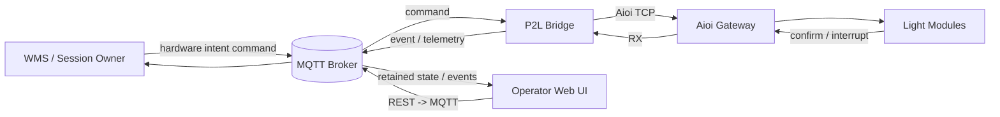

# 01 — Tổng quan hệ thống

## 1. Mục tiêu

Pick2Light kết nối ứng dụng upstream với Aioi gateway để:

- nhận yêu cầu bật/tắt/cấu hình đèn;
- đóng gói và gửi lệnh Aioi qua TCP;
- nhận interrupt/confirmation từ thiết bị;
- phát event và telemetry về upstream;
- cung cấp log TX/RX phục vụ truy vết mis-pick.

## 2. Phạm vi đúng của P2L

P2L **được phép sở hữu** trạng thái kỹ thuật ngắn hạn:

- TCP/MQTT connection và reconnect;
- hàng đợi command, sequence/ACK/NACK đang xử lý;
- last-observed device state để telemetry/diagnostic;
- event buffer khi MQTT gián đoạn;
- idempotency/deduplication có thời hạn;
- cấu hình gateway, topic và mapping address/label.

P2L **không nên sở hữu**:

- picking session, wave, order hoặc task lifecycle;
- danh sách item còn pending hay quy tắc hoàn thành session;
- quyết định relight sau restart;
- workflow xóa task CSV sau confirm;
- business decision “batch completed”.

Các trách nhiệm này thuộc WMS/upstream. Xem
[ADR-0001](adr/0001-p2l-hardware-adapter-boundary.md).

## 3. Thành phần hiện có

| Thành phần | Công nghệ | Vai trò hiện tại |
|---|---|---|
| `P2L.CLI` | .NET 10 Native AOT | Entry point, CLI, daemon `serve`, config, logging |
| `P2L.Hardware` | `System.Net.Sockets` | TCP transport, codec Aioi, reconnect, ACK/NACK |
| `P2L.Core` | .NET | Registry, heartbeat, scan, picking/batch và CSV workflow |
| `P2L.Mqtt` | MQTTnet | Command subscriber, event publisher, offline buffer |
| `P2L.Shared` | .NET | Enum, model và hằng số dùng chung |
| `client/` | Python/FastAPI | Dashboard web, REST/WebSocket, MQTT client, device DB |
| `deploy/` | Shell/PowerShell/WiX | Package và cài service |
| `tests/` | xUnit | Integration test mạng/protocol/phần cứng |

Lưu ý: `P2L.Core/PickingEngine` và `CsvPickTaskRunner` đang vượt qua ranh giới
đích vì quản lý batch/pending/completion. Đây là nợ kiến trúc, không phải contract
nên tiếp tục mở rộng.

## 4. Tác nhân và tích hợp

Web UI hiện có quyền gửi lệnh điều khiển và quản trị service. Vì chưa có auth,
chỉ được bind vào loopback hoặc đặt sau reverse proxy có kiểm soát truy cập.

## 5. Chế độ chạy

| Lệnh | Mục đích | Khuyến nghị vận hành |
|---|---|---|
| `p2l serve` | Daemon, gateway + heartbeat + MQTT | Entry point duy nhất cho service |
| `p2l light ...` | Manual hardware override | Chỉ operator được ủy quyền |
| `p2l devices` | Scan/list module | Cần cửa sổ bảo trì khi scan rộng |
| `p2l pick` | Batch workflow nội bộ | Legacy; không dùng cho kiến trúc đích |
| `p2l run tasks.csv` | CSV session và auto-delete | Legacy/rủi ro; không dùng làm service |
| `p2l` không tham số | Dashboard tương tác | Không chạy dưới service supervisor |

`serve` không chủ động gửi lệnh tắt toàn bộ khi start/stop bình thường. Chế độ
interactive và CSV có các đường gửi `Z`/`D00`; xem runbook trước khi sử dụng.

## 6. Thuật ngữ

| Thuật ngữ | Ý nghĩa trong tài liệu này |
|---|---|
| Desired state | Toàn bộ trạng thái đèn mà WMS muốn có cho một block tại một revision |
| Observed state | Trạng thái P2L quan sát/ghi nhận gần nhất; không phải nguồn sự thật business |
| Block | Phạm vi phần cứng Aioi dùng để cô lập tập module |
| Confirmation | Interrupt do operator bấm nút trên module |
| Relight/resync | WMS gửi lại desired state đầy đủ sau reconnect/restart |
| Hardware intent | Lệnh mô tả tác động mong muốn lên thiết bị, không hàm ý session lifecycle |
| D/D00 | Lệnh tắt một địa chỉ/một phạm vi; `D00` có blast radius lớn |
| P1/P5 | Lệnh apply/overwrite danh sách module cho block; danh sách thiếu có thể làm tắt module bị bỏ sót |

## 7. Ngoài phạm vi bàn giao hiện tại

- Chứng nhận tương thích cho mọi model/firmware Aioi.
- Penetration test và security approval.
- Kiểm thử tại kho với tải thực tế.
- Migration WMS sang contract vNext.
- Cam kết SLA/SLO khi chưa có owner và monitoring production.
