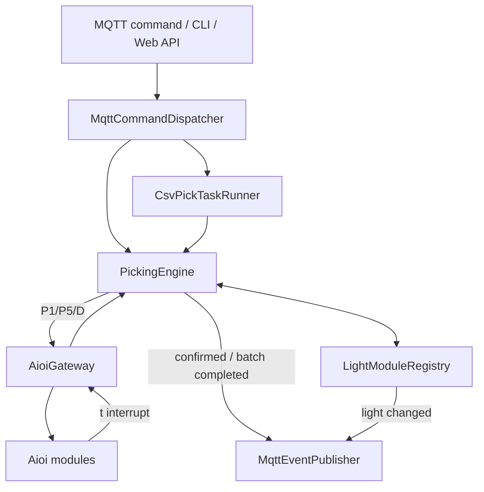
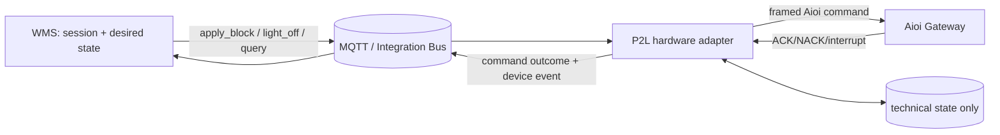
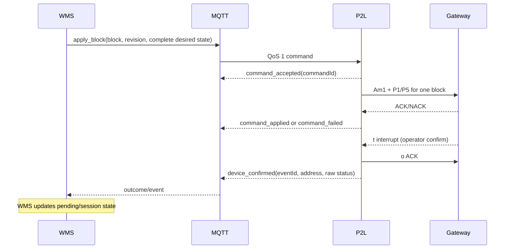
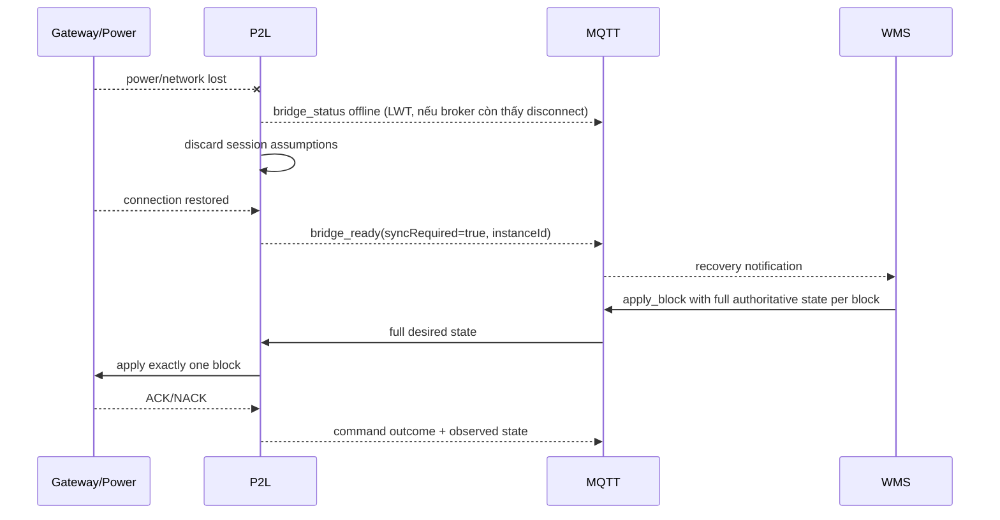

# 02 — Kiến trúc và ranh giới trách nhiệm

## 1. Kết luận

Kiến trúc hiện tại **chỉ đúng một phần** với nguyên tắc “P2L chỉ control
đèn/events, không sở hữu session”. MQTT bridge và hardware layer đã gần với
adapter pattern, nhưng `PickingEngine`, CSV runner và dashboard vẫn chứa state
và quyết định thuộc picking session.

Kiến trúc đích đã được ghi nhận tại
[ADR-0001](adr/0001-p2l-hardware-adapter-boundary.md):

- WMS/upstream sở hữu session và desired state.
- P2L nhận hardware intent, thực thi, rồi phát outcome/event/observed state.
- Sau restart, P2L không tự suy luận relight từ cache.
- Mọi thao tác full-block phải cô lập theo `blockNo`.

## 2. Hiện trạng (as-is)

Các điểm vượt ranh giới:

| Source | Hành vi hiện tại | Vì sao không thuộc P2L |
|---|---|---|
| `src/P2L.Core/PickingEngine.cs` | Giữ `_activeBatches`, pending address, phát `BatchCompleted` | Đây là lifecycle và completion của session |
| `src/P2L.Core/Services/CsvPickTaskRunner.cs` | Chạy task tuần tự, xóa row sau confirm, finish/cancel | Đây là workflow/business data ownership |
| `src/P2L.Core/Services/RegistryPersistenceService.cs` | Có thể lưu observed operating state | Cache không được trở thành nguồn phục hồi session |
| `client/app/api/routes.py` | `batch_status` suy luận active/pending/completion | Dashboard không có dữ liệu session authoritative |

## 3. Kiến trúc đích (to-be)

`TECH` chỉ gồm connection, queue, in-flight request, dedupe, event buffer và
observed-state telemetry. Nó không chứa session completion rule.

## 4. Bảng ownership

| Dữ liệu/quyết định | WMS/upstream | P2L | Dashboard |
|---|:---:|:---:|:---:|
| Session/order/wave/task | **A/R** | — | View |
| Danh sách item pending | **A/R** | — | View |
| Desired state theo block + revision | **A/R** | Cache khi xử lý | View |
| Relight sau restart | **A/R** | Thực thi | Trigger/query theo quyền |
| Completion của session | **A/R** | Phát raw confirm | View |
| Mapping gateway/block/address | C | **A/R** | Admin theo quyền |
| TCP/MQTT reconnect | I | **A/R** | View |
| ACK/NACK/timeout | I | **A/R** | View |
| Event buffering/deduplication | C | **A/R** | — |
| Manual emergency-off | Policy owner | Execute + audit | Có quyền riêng |

Ký hiệu: A = accountable, R = responsible, C = consulted, I = informed.

## 5. Invariant bắt buộc

1. Một command cho block A không được tắt hoặc ghi đè module của block B.
2. `blockNo="00"` không được dùng mặc định cho thao tác có blast radius nếu
   upstream chưa yêu cầu rõ ràng và được authorize.
3. `confirmed` chỉ mô tả sự kiện phần cứng; không tự kết luận session hoàn tất.
4. P2L restart làm mất business context; P2L phải yêu cầu resync, không tự phục
   hồi desired state từ registry/database cũ.
5. Full-block apply phải chứa desired state đầy đủ của đúng một block và có
   `revision`/`commandId` để idempotent.
6. Mỗi command phải có outcome phân biệt `accepted`, `applied` hoặc `failed`.
7. Event có thể giao ít nhất một lần; consumer phải dedupe bằng event/command ID.
8. Chỉ một bridge có cùng gateway ownership/client identity được active.

## 6. Luồng bình thường theo kiến trúc đích

Các event `command_accepted`, `command_applied` và `command_failed` chưa có đủ
trong source hiện tại; đây là contract cần bổ sung.

## 7. Luồng mất điện/restart bắt buộc

Trong cửa sổ `syncRequired=true`:

- không nhận delta `light_on` nếu nó buộc P2L tái dựng cả block từ local cache;
- không tự phát `D00`;
- không suy luận những đèn “còn lại” từ retained device event;
- upstream gửi full state riêng cho từng block.

## 8. Nguyên nhân kỹ thuật của hiện tượng đèn còn lại tự tắt

`QuickLightAsync` hiện xây lại P1/P5 từ các module có status `Operating` trong
local registry. Sau mất điện/restart, registry có thể rỗng hoặc thiếu những đèn
WMS vẫn coi là pending. Khi một đèn mới được confirm/control, danh sách P1/P5
thiếu module còn lại có thể làm gateway ghi đè full block và tắt các module bị
bỏ sót.

Ngoài ra, danh sách đang được gom từ mọi block rồi gửi theo `blockNo` của phần tử
đầu tiên. Đây là rủi ro cross-block độc lập và phải được đóng trước nghiệm thu.

Giải pháp không phải lưu session vào P2L. Giải pháp đúng là contract resync từ
session owner và full-state apply cô lập theo block.

## 9. Lộ trình tách lớp đề xuất

1. Đóng lỗ hổng credential/web access và chặn deployment path không an toàn.
2. Bổ sung command outcome, instance identity và sync-required handshake.
3. Thêm primitive hardware `apply_block`, `terminate_block`, `terminate_address`.
4. Chuyển session/pending/completion/CSV orchestration sang WMS.
5. Deprecate `batch_start`, `batch_finish`, `batch_completed`, `csv_*` theo phiên
   bản contract; giữ adapter translation tạm thời nếu cần migration.
6. Bỏ khả năng local observed cache quyết định desired state.
7. Chạy acceptance test power-loss, multi-block và duplicate delivery trên test rig.
